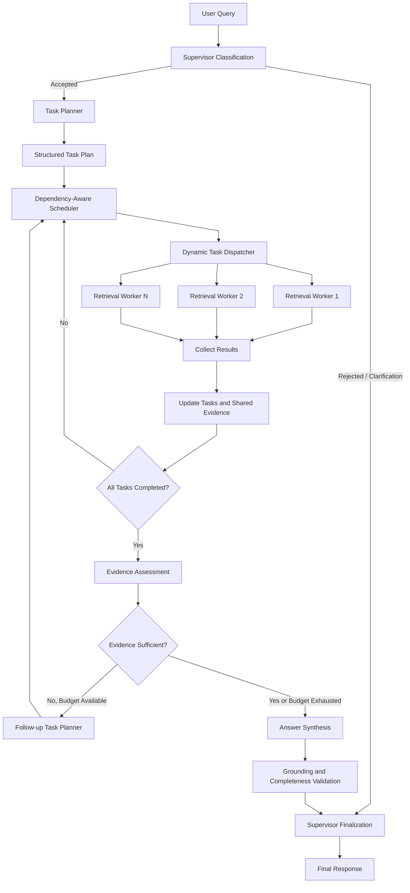
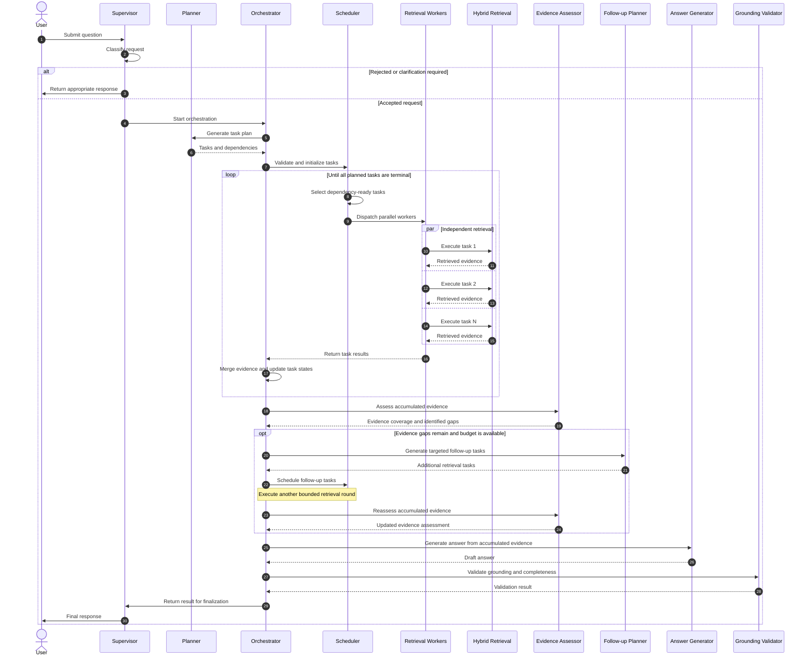

# Multi-Hop Agentic RAG

A locally running, agentic Retrieval-Augmented Generation (RAG) system designed to answer complex questions requiring information retrieval and reasoning across multiple documents.

The project explores multi-hop question answering through task planning, hybrid retrieval, reranking, evidence assessment, adaptive retrieval, and evidence-grounded answer generation, using locally hosted language models.

## Overview

Traditional RAG systems often struggle with questions that require connecting information across multiple documents.

This project addresses these limitations through a multi-hop workflow that dynamically plans retrieval tasks, gathers relevant evidence, evaluates evidence coverage, and generates answers grounded in the collected context.

The system runs locally using Ollama, without relying on hosted inference APIs.

## Problems Addressed

- **Multi-hop reasoning:** Connecting information spread across multiple documents.
- **Retrieval limitations:** Combining semantic and keyword-based search.
- **Inference latency:** Reducing unnecessary sequential LLM calls.
- **Evidence reliability:** Preserving evidence provenance and validating generated claims against retrieved sources.
- **Local resource constraints:** Optimizing inference and retrieval for local hardware.

## Technology Stack

| Component | Technology |
|---|---|
| Backend | Python, FastAPI |
| Agent orchestration | LangGraph, LangChain |
| Local inference | Ollama |
| Generation model | Llama 3 |
| Supervisor model | Qwen 2.5 1.5B |
| Embeddings | nomic-embed-text |
| Vector database | ChromaDB |
| Sparse retrieval | SQLite FTS5 BM25 |
| Reranking | BGE Reranker Base |
| Frontend | React |
| Dataset | HotpotQA |

## Data Ingestion

The project uses a 500-example sample of the HotpotQA distractor dataset for development and evaluation.

The ingestion pipeline processes the dataset, creates document chunks, generates local embeddings, and builds synchronized ChromaDB and BM25 indexes.

**Current index:**
- 500 dataset examples
- 5,348 indexed document chunks
- Consistent document IDs across both retrieval indexes

Dataset files, embeddings, and local index artifacts are excluded from Git.

## Agent Workflow

The current LangGraph workflow uses a dynamic, task-based orchestrator-worker architecture:

1. **Supervisor classification:** Classifies requests and handles invalid, out-of-scope, and prompt-injection inputs.
2. **Task planning:** Converts accepted questions into structured retrieval tasks with dependencies.
3. **Dependency-aware scheduling:** Selects ready tasks while enforcing execution and concurrency limits.
4. **Parallel retrieval:** Dispatches independent tasks to workers using the existing hybrid retrieval and reranking pipeline.
5. **Evidence aggregation:** Merges retrieved documents using stable IDs while preserving task provenance and retrieval-round metadata.
6. **Evidence assessment:** Evaluates evidence coverage against the original information requirements.
7. **Bounded evidence recovery:** Creates targeted follow-up retrieval tasks when gaps remain and the configured follow-up budget permits.
8. **Answer synthesis:** Produces a structured answer from accumulated evidence.
9. **Grounding validation:** Checks answer claims against retrieved evidence and applies a fail-closed response policy when support is insufficient or validation fails.
10. **Supervisor finalization:** Returns the validated result through the supervisor's final response path.

Independent retrieval tasks can run concurrently. LLM generation remains controlled for the local hardware environment. The workflow no longer depends on sequential intermediate-answer generation for every sub-question.

## Performance Optimization

The original workflow was optimized to reduce unnecessary LLM calls and improve response latency.

Key improvements include:
- Reduced intermediate generation calls.
- Reuse of initialized LLM instances.
- Configurable retrieval limits.
- Token-by-token streaming of final answers.

**Development benchmark:**

| Metric | Before | After |
|---|---:|---:|
| Average latency | 17.67s | 7.00s |
| Median latency | 16.53s | 7.48s |
| P95 latency | 28.02s | 11.90s |
| LLM calls per query | 6-12 | 3 |

These measurements represent an earlier development benchmark and are not a benchmark of the complete current system.

## Hybrid Retrieval

The retrieval layer combines dense vector search and BM25 keyword search.

**Retrieval pipeline:**

1. Dense retrieval using ChromaDB.
2. BM25 retrieval using SQLite FTS5.
3. Reciprocal Rank Fusion (RRF) to combine results.
4. Deduplication using stable document IDs.
5. BGE reranking to prioritize relevant evidence.

The system retrieves up to 10 candidates from each retrieval method, combines them, and passes the top 5 reranked documents to the agent.

**Retrieval evaluation:**

A preliminary 20-question HotpotQA evaluation showed that reranking improved the quality of the top-ranked results:

| Metric | Dense | Reranked |
|---|---:|---:|
| Recall@5 | 85.0% | 92.5% |
| Recall@10 | 85.0% | 95.0% |
| MRR@10 | 0.913 | 1.000 |
| nDCG@5 | 0.826 | 0.936 |

These results are preliminary and require validation on a larger evaluation set.

## Agentic Architecture Restructuring

**Status: Completed**

Phase 5 evolved the original sequential multi-hop workflow into a dynamic, planner-driven agentic RAG architecture.

The orchestrator plans retrieval tasks, manages dependencies, dispatches independent workers, aggregates evidence, evaluates evidence gaps, and schedules bounded follow-up retrieval when needed. Answer synthesis and grounding validation are integrated into the LangGraph workflow before supervisor finalization.

The implementation preserves the existing hybrid retrieval infrastructure, supervisor, local model setup, and token-streaming frontend contract.

### Architecture Overview

The architecture consists of the following components:

1. **Supervisor:** Classifies incoming requests, determines whether they are in scope, and owns final response routing and finalization.
2. **Task Planner:** Converts the original question into structured retrieval tasks, identifying independent information requirements and task dependencies.
3. **Task Manager:** Validates task plans, dependency relationships, unique task IDs, and execution limits.
4. **Task Scheduler:** Determines which tasks are ready for execution and manages task status, dependencies, and concurrency.
5. **Dynamic Task Dispatcher:** Uses LangGraph `Send` to dispatch independent retrieval tasks to workers in parallel.
6. **Retrieval Workers:** Execute individual retrieval tasks using the existing hybrid retrieval and reranking infrastructure.
7. **Evidence Aggregation:** Collects and deduplicates retrieved documents while preserving their source-task provenance.
8. **Evidence Assessor:** Evaluates whether the collected evidence sufficiently covers the original information requirements and identifies missing information.
9. **Follow-up Planner:** Creates targeted retrieval tasks when evidence gaps remain, subject to configured execution limits.
10. **Answer Synthesis:** Generates a structured final answer using accumulated evidence and known evidence IDs.
11. **Grounding and Validation:** Checks generated claims against retrieved evidence and applies the grounding policy.
12. **Supervisor Finalization:** Returns the validated answer or safe abstention to the user.

### High-Level Architecture Flow

### Sequential Execution: Query to Answer

The following sequence illustrates how the system processes a question. Independent retrieval tasks within the same execution batch run concurrently.

### Task Execution and Dependency Management

Tasks are represented as structured records containing:

- Task ID and question.
- Retrieval query.
- Dependency references.
- Execution status.
- Priority and follow-up round.
- Retrieved evidence IDs.
- Attempt count and error information.

Independent tasks can execute concurrently, while dependent tasks wait until their prerequisites have completed.

LangGraph's `StateGraph`, conditional routing, state reducers, and `Send` are used to coordinate dynamic execution.

### Evidence Assessment and Adaptive Retrieval

After the currently planned retrieval tasks finish, the evidence assessor evaluates the accumulated documents against the original task requirements.

Evidence is maintained as structured records containing document IDs, content, metadata, and source-task references. Duplicate documents are merged without losing provenance.

When evidence gaps remain, the follow-up planner can create additional targeted retrieval tasks. Their results are added to the shared evidence collection and reassessed against the original information requirements.

The evidence assessor uses evidence-coverage diagnostics to identify retrieval gaps; this assessment is not itself a factual-entailment score.

Final answer grounding is handled separately by a local LLM claim-to-evidence validator. The validator checks that supported claims reference known evidence IDs and distinguishes supported, partially supported, unsupported, and validation-error outcomes.

- **Supported:** The answer proceeds to supervisor finalization.
- **Partially supported:** Supported claims are retained while unsupported content is excluded.
- **Unsupported:** The system returns a transparent abstention response.
- **Validation error:** The system fails closed with a safe response.

The grounding node is integrated into the LangGraph path after answer synthesis and before supervisor finalization. No unbounded retrieval loop is introduced.

### Execution Controls

The architecture uses configurable execution limits to prevent uncontrolled task creation and resource consumption.

| Control | Behavior |
|---|---|
| Planned task limit | Caps the number of tasks created for an original question. |
| Follow-up round limit | Bounds adaptive retrieval and prevents an open-ended recovery loop. |
| Retrieval concurrency | Caps the number of retrieval workers executing at the same time. |
| Retrieval candidate and rerank limits | Controls the evidence volume passed through retrieval and reranking. |
| Generation concurrency and timeout | Keeps local model usage controlled and bounds model-call duration. |

The runtime limits are configurable in the backend. They prioritize parallel retrieval while keeping local LLM generation controlled for the target Apple M2 machine with 16 GB unified memory.

### Phase 5 Completion

Phase 5 implementation is complete:

- **Stage 5: Evidence assessment and adaptive retrieval**
  - Integrated task planning and dependency-aware scheduling.
  - Implemented parallel retrieval through the existing hybrid retrieval and reranking pipeline.
  - Added evidence aggregation and deduplication using stable document IDs.
  - Preserved task provenance and retrieval-round metadata.
  - Integrated evidence-gap assessment and bounded follow-up retrieval.

- **Stage 6: Answer synthesis and grounding**
  - Implemented structured answer synthesis from accumulated evidence.
  - Preserved evidence references and provenance in the synthesis context.
  - Added claim-to-evidence grounding validation.
  - Added handling for supported, partially supported, unsupported, and invalid synthesis outcomes.

- **Stage 7: Grounding policy and final graph integration**
  - Integrated grounding validation into the LangGraph execution path.
  - Added conditional routing based on grounding results.
  - Preserved supported claims and excluded unsupported content.
  - Implemented fail-closed behavior for unsupported answers and validation errors.
  - Integrated the validated result with supervisor finalization.

**Backend verification:**

The complete backend test suite passes **72 of 72 tests**, covering:

- Hybrid retrieval and reciprocal rank fusion.
- BM25 and ChromaDB index synchronization.
- Task execution and evidence provenance.
- Evidence assessment and bounded follow-up recovery.
- Stage 6 answer synthesis and grounding.
- Stage 7 LangGraph grounding integration and response policies.
- Native Ollama structured token streaming.
- Vector-store integration.

Phase 5 is closed from an implementation perspective. Broader answer-quality evaluation and benchmark comparisons remain part of the project roadmap.

## Development Progress

| Phase | Phase Title | Description | Status |
|---|---|---|---|
| 1 | Existing Architecture and Baseline | Review the original agentic RAG architecture, preserve its core multi-hop workflow, and establish baseline performance using local Ollama models and the existing retrieval infrastructure. | Completed |
| 2 | Supervisor and Query Classification | Introduce a central supervisor for query classification, scope validation, prompt-injection handling, workflow routing, and final response control. | Completed |
| 3 | Initial Evaluation Framework | Establish the initial evaluation structure and baseline measurements to support future retrieval and answer-quality improvements. | Deferred |
| 4 | Retrieval Improvements | Implement hybrid dense and BM25 retrieval, reranking, and end-to-end integration. Query expansion and MMR were deliberately skipped because they did not demonstrate sufficient benefit. | Completed |
| 5 | Agentic Architecture and Evidence Grounding | Complete the task-based agentic workflow with planning, dependency-aware scheduling, parallel hybrid retrieval, evidence aggregation and provenance, evidence assessment, bounded follow-up retrieval, structured answer synthesis, claim-to-evidence grounding, and fail-closed validation integrated into LangGraph and supervisor finalization. | Completed |
| 6 | Answer Evaluation and Guardrails | Evaluate answer quality across correctness, hallucination, precision, completeness, and relevance. Retain quantitative metrics such as Exact Match, Token F1, retrieval Recall, and latency, and introduce additional guardrails to improve answer reliability. | Planned |
| 7 | Frontend Integration and Multi-Organization Support | Integrate a user-facing frontend and evolve the platform for multiple organizations. Introduce organization-aware data isolation, domain-based ingestion, and generic user-driven knowledge ingestion. | Planned |
| 8 | Reliability and Production Hardening | Improve error handling, recovery, timeout management, and failure handling across agent stages. Strengthen consistency across question types, resource and memory management, and overall system robustness through testing. | Planned |
| 9 | Observability and Final Optimization | Improve execution tracing and monitoring, measure individual agent-stage performance, and identify bottlenecks. Optimize model calls and workflow execution, improve end-to-end latency, and conduct final system-wide evaluation. | Planned |

**Deferred work:** Query expansion and MMR were considered but skipped because the existing hybrid retrieval and reranking pipeline provides a strong foundation. Additional retrieval techniques can be introduced later if evaluation identifies a need.

## Project Goal

The long-term goal is to develop a reliable, fully local agentic RAG system that can autonomously plan multi-hop questions, retrieve sufficient evidence, reason across multiple sources, and produce accurate, well-grounded answers.

The architecture will evolve based on measured weaknesses in the current system, rather than introducing additional agentic components without evidence.