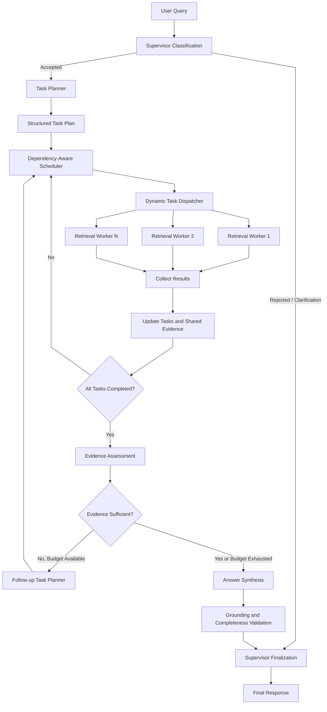
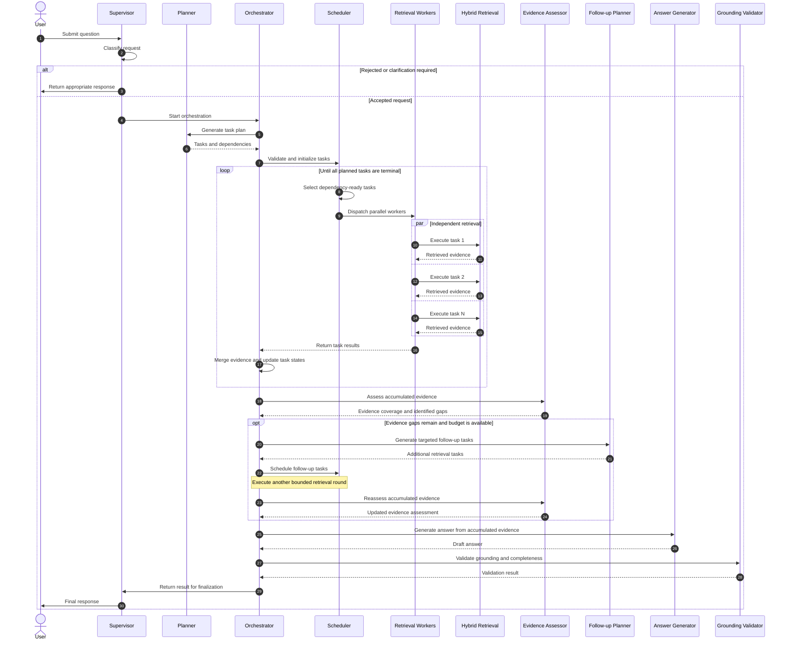

# Multi-Hop Agentic RAG

A locally running, agentic Retrieval-Augmented Generation (RAG) system designed to answer complex questions requiring information retrieval and reasoning across multiple documents.

The project explores multi-hop question answering through question decomposition, hybrid retrieval, reranking, and evidence-based answer generation, using locally hosted language models.

## Overview

Traditional RAG systems often struggle with questions that require connecting information across multiple documents.

This project addresses these limitations through a multi-hop workflow that decomposes complex questions, retrieves relevant evidence, and generates answers from the collected context.

The system runs locally using Ollama, without relying on hosted inference APIs.

## Problems Addressed

- **Multi-hop reasoning:** Connecting information spread across multiple documents.
- **Retrieval limitations:** Combining semantic and keyword-based search.
- **Inference latency:** Reducing unnecessary sequential LLM calls.
- **Local resource constraints:** Optimizing inference and retrieval for local hardware.

## Technology Stack

| Component | Technology |
|---|---|
| Backend | Python, FastAPI |
| Agent orchestration | LangGraph, LangChain |
| Local inference | Ollama |
| Generation model | Llama 3 |
| Supervisor model | Qwen 2.5 1.5B |
| Embeddings | nomic-embed-text |
| Vector database | ChromaDB |
| Sparse retrieval | SQLite FTS5 BM25 |
| Reranking | BGE Reranker Base |
| Frontend | React |
| Dataset | HotpotQA |

## Data Ingestion

The project uses a 500-example sample of the HotpotQA distractor dataset for development and evaluation.

The ingestion pipeline processes the dataset, creates document chunks, generates local embeddings, and builds synchronized ChromaDB and BM25 indexes.

**Current index:**
- 500 dataset examples
- 5,348 indexed document chunks
- Consistent document IDs across both retrieval indexes

Dataset files, embeddings, and local index artifacts are excluded from Git.

## Agent Workflow

The current LangGraph workflow follows a predefined multi-hop execution path:

1. **Supervisor classification:** Classifies requests and handles invalid or out-of-scope inputs.
2. **Question decomposition:** Breaks complex questions into smaller sub-questions.
3. **Query rewriting:** Refines sub-questions for retrieval.
4. **Sequential retrieval and reasoning:** Retrieves evidence and generates intermediate answers for each sub-question.
5. **Final answer generation:** Combines intermediate answers and supporting evidence.
6. **Supervisor finalization:** Handles the final response.

The current workflow is structured and sequential. More advanced planning, evidence sufficiency checks, and adaptive reasoning are not yet implemented.

## Performance Optimization

The existing workflow was optimized to reduce unnecessary LLM calls and improve response latency.

Key improvements include:
- Reduced intermediate generation calls.
- Reuse of initialized LLM instances.
- Configurable retrieval limits.
- Token-by-token streaming of final answers.

**Development benchmark:**

| Metric | Before | After |
|---|---:|---:|
| Average latency | 17.67s | 7.00s |
| Median latency | 16.53s | 7.48s |
| P95 latency | 28.02s | 11.90s |
| LLM calls per query | 6-12 | 3 |

These measurements represent an earlier development benchmark and are not a benchmark of the complete current system.

## Hybrid Retrieval

The retrieval layer combines dense vector search and BM25 keyword search.

**Retrieval pipeline:**

1. Dense retrieval using ChromaDB.
2. BM25 retrieval using SQLite FTS5.
3. Reciprocal Rank Fusion (RRF) to combine results.
4. Deduplication using stable document IDs.
5. BGE reranking to prioritize relevant evidence.

The system retrieves up to 10 candidates from each retrieval method, combines them, and passes the top 5 reranked documents to the agent.

**Retrieval evaluation:**

A preliminary 20-question HotpotQA evaluation showed that reranking improved the quality of the top-ranked results:

| Metric | Dense | Reranked |
|---|---:|---:|
| Recall@5 | 85.0% | 92.5% |
| Recall@10 | 85.0% | 95.0% |
| MRR@10 | 0.913 | 1.000 |
| nDCG@5 | 0.826 | 0.936 |

These results are preliminary and require validation on a larger evaluation set.

## Agentic Architecture Restructuring

**Status: In Progress**

Phase 5 restructures the existing sequential multi-hop workflow into a dynamic, planner-driven agentic RAG architecture.

Instead of following a predefined sequence of retrieval and reasoning steps, the new architecture introduces a central orchestrator that plans tasks, manages dependencies, dispatches retrieval workers, evaluates collected evidence, and determines whether additional retrieval is required.

The objective is to build an orchestrator-worker architecture while preserving the existing retrieval infrastructure, supervisor, and local model setup.

### Architecture Overview

The architecture consists of the following components:

1. **Supervisor:** Classifies incoming requests, determines whether they are in scope, and owns final response routing and finalization.
2. **Task Planner:** Converts the original question into structured retrieval tasks, identifying independent information requirements and task dependencies.
3. **Task Manager:** Validates task plans, dependency relationships, unique task IDs, and execution limits.
4. **Task Scheduler:** Determines which tasks are ready for execution and manages task status, dependencies, and concurrency.
5. **Dynamic Task Dispatcher:** Uses LangGraph `Send` to dispatch independent retrieval tasks to workers in parallel.
6. **Retrieval Workers:** Execute individual retrieval tasks using the existing hybrid retrieval and reranking infrastructure.
7. **Evidence Aggregation:** Collects and deduplicates retrieved documents while preserving their source-task provenance.
8. **Evidence Assessor:** Evaluates whether the collected evidence sufficiently covers the original information requirements and identifies missing information.
9. **Follow-up Planner:** Creates targeted retrieval tasks when evidence gaps remain, subject to configured execution limits.
10. **Answer Synthesis:** Generates the final answer using accumulated evidence.
11. **Grounding and Validation:** Checks answer support and completeness before supervisor finalization.

### High-Level Architecture Flow

### Sequential Execution: Query to Answer

The following sequence illustrates how the system processes a question. Independent retrieval tasks within the same execution batch run concurrently.

### Task Execution and Dependency Management

Tasks are represented as structured records containing:

- Task ID and question.
- Retrieval query.
- Dependency references.
- Execution status.
- Priority and follow-up round.
- Retrieved evidence IDs.
- Attempt count and error information.

Independent tasks can execute concurrently, while dependent tasks wait until their prerequisites have completed.

LangGraph's `StateGraph`, conditional routing, state reducers, and `Send` are used to coordinate dynamic execution.

### Evidence Assessment and Adaptive Retrieval

After the currently planned retrieval tasks finish, the evidence assessor evaluates the accumulated documents against the original task requirements.

Evidence is maintained as structured records containing document IDs, content, metadata, and source-task references. Duplicate documents are merged without losing provenance.

When evidence gaps remain, the follow-up planner can create additional targeted retrieval tasks. Their results are added to the shared evidence collection and reassessed against the original information requirements.

The current evidence assessment uses lexical term coverage as a retrieval diagnostic. It is not a semantic entailment or factual-confidence measure. Stronger grounding and answer verification are part of the subsequent implementation work.

### Execution Controls

The architecture uses configurable execution limits to prevent uncontrolled task creation and resource consumption.

| Setting | Initial Value | Purpose |
|---|---:|---|
| `MAX_PLANNED_TASKS` | 4 | Maximum planned tasks |
| `MAX_FOLLOWUP_ROUNDS` | 1 | Maximum adaptive retrieval rounds |
| `MAX_RETRIEVAL_CONCURRENCY` | 3 | Concurrent retrieval workers |
| `MAX_RETRIEVAL_RETRIES` | 1 | Intended retrieval retry limit |
| `TASK_RERANK_LIMIT` | 5 | Reranked documents per task |
| `MAX_CONCURRENT_GENERATIONS` | 1 | Concurrent generation limit |

The design prioritizes parallel retrieval while keeping local LLM generation controlled for the target Apple M2 machine with 16 GB unified memory.

### Remaining Work

The restructuring will continue through the following stages:

- **Stage 5: Evidence assessment and adaptive retrieval:** Complete and validate retrieval integration, evidence aggregation, and bounded follow-up execution.
- **Stage 6: Answer synthesis and grounding:** Generate answers from structured evidence, preserve provenance, and implement grounding and completeness validation.
- **Stage 7: Supervisor integration and final graph:** Verify routing, finalization, error handling, and compatibility with the existing token-streaming frontend.
- **Stage 8: End-to-end integration and evaluation:** Validate the complete workflow using local models and indexes, test failure scenarios, and compare latency and answer quality against the existing baseline.

The restructuring is intended to evolve the existing system incrementally, retaining its local-first design and established retrieval infrastructure rather than replacing the original implementation.

## Development Progress

| Phase | Phase Title | Description | Status |
|---|---|---|---|
| 1 | Existing Architecture and Baseline | Review the original agentic RAG architecture, preserve its core multi-hop workflow, and establish baseline performance using local Ollama models and the existing retrieval infrastructure. | Completed |
| 2 | Supervisor and Query Classification | Introduce a central supervisor for query classification, scope validation, prompt-injection handling, workflow routing, and final response control. | Completed |
| 3 | Initial Evaluation Framework | Establish the initial evaluation structure and baseline measurements to support future retrieval and answer-quality improvements. | Deferred |
| 4 | Retrieval Improvements | Implement hybrid dense and BM25 retrieval, reranking, and end-to-end integration. Query expansion and MMR were deliberately skipped because they did not demonstrate sufficient benefit. | Completed |
| 5 | Agentic Architecture and Evidence Grounding | Restructure the sequential workflow into a task-based agentic architecture with planning, dependency-aware execution, parallel retrieval, evidence assessment, and adaptive retrieval. Implement grounded answer synthesis, evidence traceability, source attribution, and citations to reduce unsupported claims. | In Progress |
| 6 | Answer Evaluation and Guardrails | Evaluate answer quality across correctness, hallucination, precision, completeness, and relevance. Retain quantitative metrics such as Exact Match, Token F1, retrieval Recall, and latency, and introduce additional guardrails to improve answer reliability. | Planned |
| 7 | Frontend Integration and Multi-Organization Support | Integrate a user-facing frontend and evolve the platform for multiple organizations. Introduce organization-aware data isolation, domain-based ingestion, and generic user-driven knowledge ingestion. | Planned |
| 8 | Reliability and Production Hardening | Improve error handling, recovery, timeout management, and failure handling across agent stages. Strengthen consistency across question types, resource and memory management, and overall system robustness through testing. | Planned |
| 9 | Observability and Final Optimization | Improve execution tracing and monitoring, measure individual agent-stage performance, and identify bottlenecks. Optimize model calls and workflow execution, improve end-to-end latency, and conduct final system-wide evaluation. | Planned |

**Deferred work:** Query expansion and MMR were considered but skipped because the existing hybrid retrieval and reranking pipeline provides a strong foundation. Additional retrieval techniques can be introduced later if evaluation identifies a need.

## Project Goal

The long-term goal is to develop a reliable, fully local agentic RAG system that can autonomously plan multi-hop questions, retrieve sufficient evidence, reason across multiple sources, and produce accurate, well-grounded answers.

The architecture will evolve based on measured weaknesses in the current system, rather than introducing additional agentic components without evidence.
